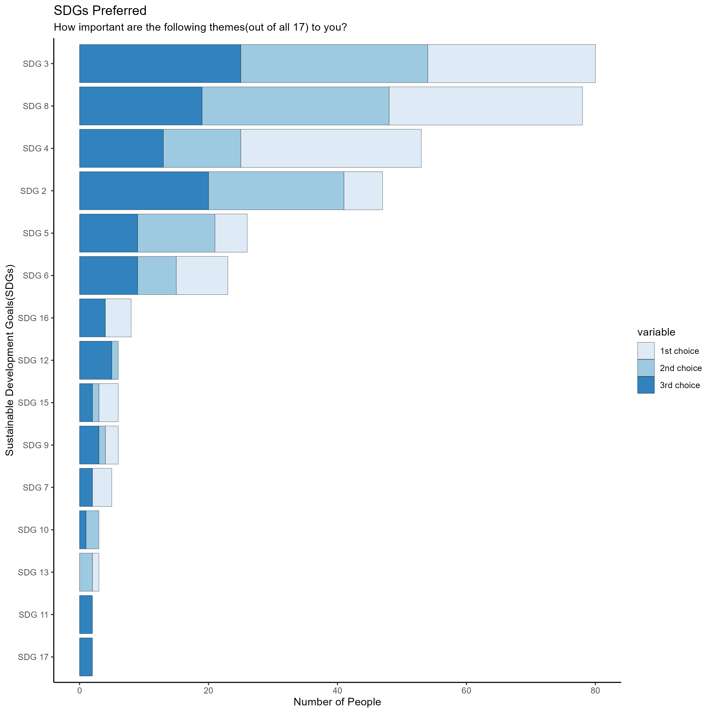

# Fair migration

## set up

```{r message=FALSE}
#| message:false

library(tidyverse)
library(here)

```

This file expects all scripts in `pipeline` have been run locally.

```{r message=FALSE}
#| error: true

ao_top_3 <- read_csv(here("pipeline/pipeline-data/analytical_ranking_top_3.csv"))

```


## recreate barplot




> We need to investigate why we have different numbers.

> SDG labelling does not seem to be correct. 

```{r fig.width=12}

# recreate horizontal stacked barplot
# y axis: sdg_text
# y axis ordered by count descending 
# x axis: count of participants
# stack: ranking
# data : ao_top_3
# we need to work into subtitle or x axis? or
# or caption what the total number of participants across
# both regions were 

# for validation we need to filter to tehri
tehri_top_3 <- ao_top_3 |>
  filter(region == "tehri")

# Calculate total counts per sdg_label for ordering
sdg_order <- tehri_top_3 |>
  group_by(sdg_label) |>
  summarise(total_n = n_distinct(respondent_id), .groups = "drop")

# Join total_n to plotdat
plotdat <- tehri_top_3 |>
  group_by(sdg_label, ranking) |>
  summarise(n = n_distinct(respondent_id), .groups = "drop") |>
  left_join(sdg_order, by = "sdg_label")

# Plot, ordering by total_n
ggplot(plotdat, aes(x = n, y = fct_reorder(sdg_label, total_n), fill = factor(ranking))) +
  geom_col(position = "stack") +
  labs(
    x = "Number of Participants",
    y = NULL,
    fill = "Ranking",
    title = "SDG Preferences by Ranking (Ordered by Total Count)"
  ) +
  theme_minimal(base_size = 16)


```
